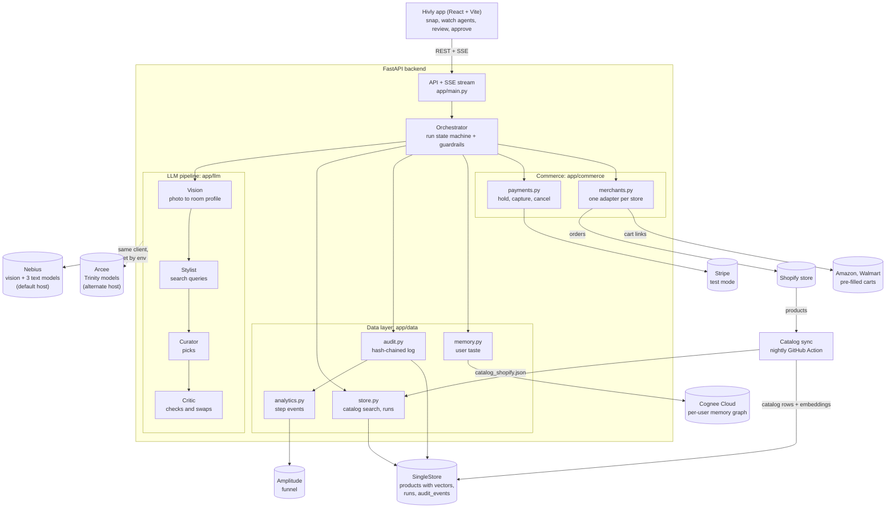
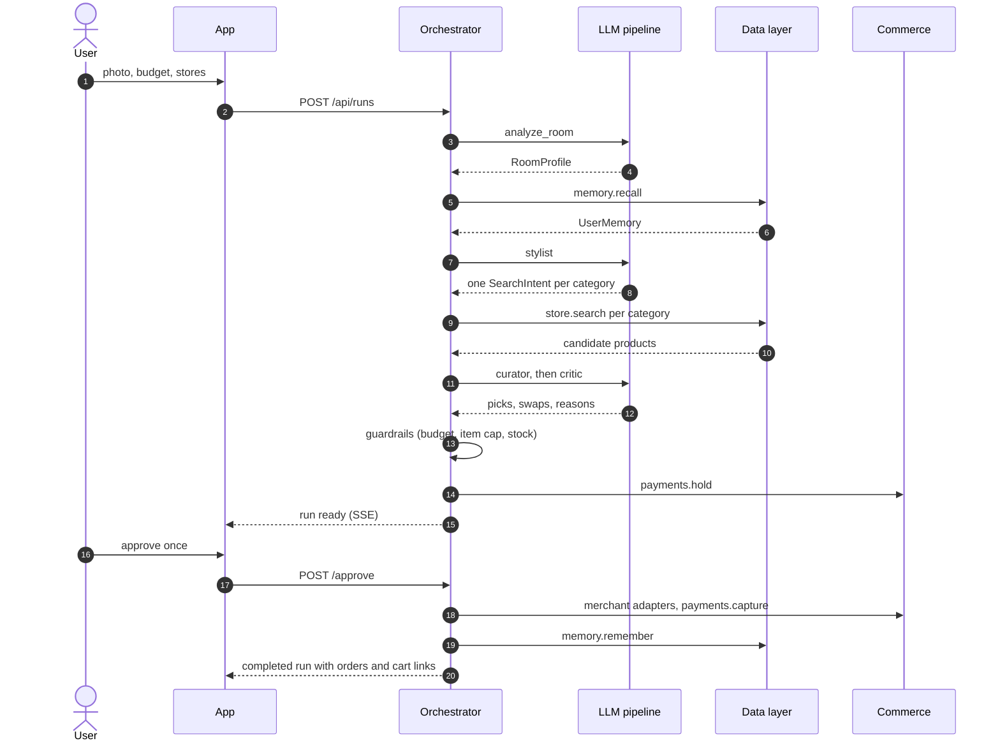
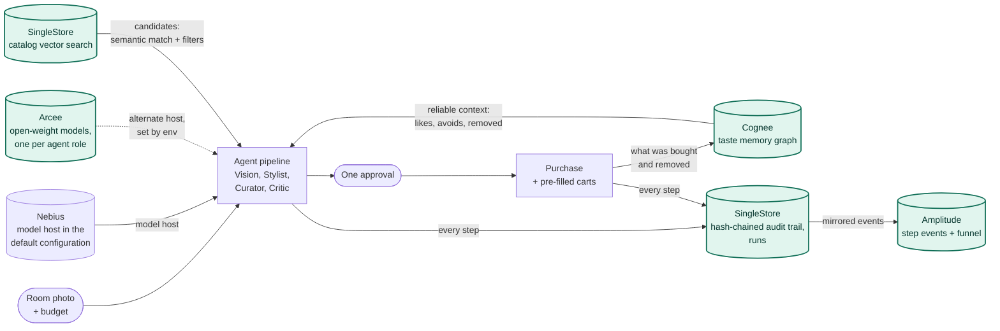

# Roomie

Roomie turns one room photo into a matched shopping list across stores, and the user approves
everything with one tap.

- **Problem:** furnishing a room means hunting across Amazon, Walmart and small shops for items
  that match a style you can't name.
- **What the agent does:** reads the photo, recalls the user's taste, searches a multi-store
  catalog, has three LLMs suggest, curate and critique, enforces budget rules in code, then
  executes on one approval.
- **One approval:** items from our Shopify dev store are really bought (Stripe test-mode hold,
  then capture, plus a Shopify order). Amazon and Walmart items land in pre-filled carts.
- **Audit trail:** every step is a hash-chained event, mirrored to Amplitude and shown live in
  the app.

The app is branded **Hivly**; Roomie is the project and backend name.

To run it, see [backend/README.md](backend/README.md).

## System diagram



Only the orchestrator calls the other modules. Each module sits behind a fixed Python
interface in [backend/app/contracts.py](backend/app/contracts.py), so every part has a mock
and a real implementation that can be swapped with an environment flag.

The catalog sync is the one piece that runs outside a user's request: it copies the Shopify
store's kitchen products into the catalog so the agents recommend things that can really be
ordered.

## What happens in one run



After every step the orchestrator calls `audit.append`, which records one event, mirrors it to
analytics, and pushes it to the app over SSE.

| # | Step | What it does | Module |
|---|---|---|---|
| 1 | Perceive | Photo and note become a `RoomProfile` (style, palette, missing categories) | `llm.analyze_room` |
| 2 | Recall | Fetch what we know about this user's taste | `data.memory.recall` |
| 3 | Stylist | One search query and constraints per missing category | `llm.stylist` |
| 4 | Retrieve | Top candidates per category from the catalog | `data.store.search` |
| 5 | Curator | One pick per category, with a reason | `llm.curator` |
| 6 | Critic | Independent check; may swap a pick for another candidate | `llm.critic` |
| 7 | Guardrails | Budget, per-item cap, in-stock, in plain code | orchestrator |
| 8 | Hold | Stripe PaymentIntent with manual capture, auto-buy items only | `commerce.payments` |
| 9 | Approve | User taps once | app |
| 10 | Execute | Shopify order and Stripe capture; Amazon and Walmart cart links | `commerce.merchants` |
| 11 | Learn | Purchases and removals written to memory | `data.memory.remember` |

Run states: `created` → `analyzing` → `awaiting_approval` → `executing` →
`completed` | `partial` | `rejected` | `failed`.

## Design decisions

**Three LLM roles instead of one prompt.** The Stylist translates the room into shopping
intent, the Curator chooses, and the Critic checks. Splitting them gives better picks and three
readable "why" steps in the audit trail. The LLMs may only choose product ids that appear in
the candidates they were given; the orchestrator drops anything else.

**The model host is configuration.** The LLM client speaks the OpenAI-compatible chat API and
reads its base URL, key and one model name per role (`NEBIUS_BASE_URL`, `NEBIUS_API_KEY`,
`NEBIUS_MODEL_VISION`, `_STYLIST`, `_CURATOR`, `_CRITIC`) from the environment. The pipeline was
designed around Arcee's Trinity models, one size per role (a small model for the Stylist, a
larger reasoning model for the Curator, a third for the Critic), and the app labels the steps
that way. The defaults in `.env.example` point at Nebius; pointing them at another
OpenAI-compatible host such as Arcee is a configuration change.

**Rules live in code, not prompts.** Budget, the per-item cap and stock checks run after the
LLMs and cannot be talked out of.

**Mock first, real behind a flag.** `MOCK=1` forces every integration to its mock. Each real
integration has its own flag (`USE_NEBIUS`, `USE_SINGLESTORE`, `USE_COGNEE`, `USE_AMPLITUDE`,
`USE_STRIPE`, `USE_SHOPIFY`), so a broken service can be switched off on stage without touching
the others.

**Every external call can fail.** The data layer falls back to its in-memory mock on any
error. After a SingleStore failure it skips the database for 30 seconds so a run does not wait
on repeated timeouts. Memory recall is limited to 12 seconds, and analytics never raises.

## Data layer

| Module | Why it exists | Real backend | Fallback |
|---|---|---|---|
| `store.py` | The LLMs need real products with real store ids, and a run must survive between "plan" and "approve" | SingleStore `products` and `runs` | In-memory catalog and dict |
| `audit.py` | Every step needs a record the user can read and trust | SingleStore `audit_events` | In-memory list |
| `memory.py` | The second run should know what the user removed the first time | Cognee Cloud, one dataset per user | Local `memory.json` |
| `analytics.py` | Funnel of where runs drop off | Amplitude | Console print |

**Catalog search.** Product text is embedded with `BAAI/bge-small-en-v1.5` (384 dimensions,
normalised, so dot product equals cosine). A search embeds the Stylist's query and runs one
SQL statement:

```sql
SELECT ..., vec <*> (:query_vec :> VECTOR(384)) AS score
FROM products
WHERE in_stock = 1 AND LOWER(category) = :category AND room = :room
  AND store IN (...) AND price_usd <= :max_price
ORDER BY score DESC LIMIT :k
```

Products that contain a term the user avoids are pushed down the ranking.

The vision model names categories in its own words, so search first maps each one onto a
catalog category: exact match, then a short alias list, then the same head noun ("kitchen
towels" finds "dish towels"). A category with no equivalent returns nothing and is skipped.

**Catalog sync.** `scripts/sync_shopify_catalog.py` reads every active product from the Shopify
store, keeps the kitchen ones, and maps each to a catalog row with its real variant id, image,
price, style and stock. It writes `backend/catalog_shopify.json`, which the in-memory catalog
loads at startup, and upserts into SingleStore with embeddings when `SINGLESTORE_URL` is set.
Products no longer in the store are marked out of stock, and a pull that returns no kitchen
products changes nothing. A GitHub Action runs it nightly.

**Tables.**

| Table | Key | Holds |
|---|---|---|
| `products` | `id` | Catalog rows plus the `vec VECTOR(384)` embedding |
| `runs` | `id` | The full `Run` object as JSON, rewritten on each state change |
| `audit_events` | `(run_id, seq)` | One row per step, with `prev_hash` and `hash` |
| `merchant_orders` | `(run_id, store)` | One row per store result after approval |

**Audit hash chain.** Each event is hashed together with the one before it:

```
hash = sha256(prev_hash + run_id + seq + ts + actor + action + json(data, sort_keys=True))
```

`prev_hash` is 64 zeros for the first event. `verify_chain` recomputes every hash, so editing
any earlier event breaks the chain; the app's "chain verified" badge comes from that check.

**Memory.** Every fact is written to the local file first. With Cognee on, the fact is also
sent to the user's dataset in the background, where Cognee builds a knowledge graph from it.
Recall asks that graph a question ("what does this user like, dislike or avoid?") and passes
the answer to the Stylist and Critic.

**Analytics events.** `run_started`, `room_analyzed`, `memory_recalled`, `llm_stylist_done`,
`catalog_searched`, `llm_curator_done`, `llm_critic_done`, `guardrails_passed`,
`guardrails_blocked`, `payment_held`, `run_approved`, `merchant_executed`, `payment_captured`,
`run_rejected`, `run_failed`. Each carries `run_id`, `user_id`, `room_type` and `style`. The
demo funnel is `run_started` → `run_approved` → `payment_captured`.

## API

All JSON is snake_case, money is USD, times are ISO-8601 UTC.

| Method and path | Purpose |
|---|---|
| `GET /api/health` | Which integrations are real and which are mocked |
| `POST /api/runs` | Start a run (multipart: `photo`, `user_id`, `budget_usd`, `stores`, `note`) |
| `GET /api/runs/{id}/events` | Live SSE stream: `step`, `state`, `run`, `error` |
| `GET /api/runs/{id}` | The current `Run`; poll this if SSE fails |
| `POST /api/runs/{id}/approve` | Execute the selected items |
| `POST /api/runs/{id}/reject` | Cancel the plan |
| `GET /api/runs/{id}/audit` | All audit events plus `chain_valid` |

Errors return `{"error": {"code", "message"}}` with one of `RUN_NOT_FOUND`, `INVALID_STATE`,
`BAD_INPUT`, `PAYMENT_FAILED`, `LLM_TIMEOUT`, `INTERNAL`.

## Repo layout

| Path | Owner | Contents |
|---|---|---|
| `backend/app/main.py`, `orchestrator.py`, `events.py` | Rohit | Routes, SSE stream, run state machine |
| `backend/app/contracts.py` | Rohit | Shared Pydantic models (frozen) |
| `backend/app/llm/` | Jaideep | Vision, Stylist, Curator, Critic; model host set by env |
| `backend/app/data/` | Suman | Catalog and runs, audit, memory, analytics |
| `backend/app/commerce/` | Rohit | Stripe payments and store adapters |
| `backend/scripts/seed_data.py` | Suman | Creates tables, loads the catalog, seeds the demo user |
| `backend/scripts/sync_shopify_catalog.py` | Suman | Pulls Shopify kitchen products into the catalog |
| `.github/workflows/catalog-sync.yml` | Suman | Runs the catalog sync nightly and on demand |
| `backend/tests/` | Suman | Data-layer tests |
| `backend/fixtures/` | Rohit | Contract-shaped JSON for frontend development |
| `frontend/` | Naman | Hivly app: React + Vite, live SSE client, built-in mock API |

## Sponsor technology

Built for the Personal Agents Hackathon challenge: *a shopping agent with an audit trail*.
The diagram shows where each event sponsor's technology sits in a run.



| Sponsor | What it does in Roomie | Where in the code |
|---|---|---|
| Cognee | The agent's reliable context. Each user has a dataset on Cognee Cloud; purchases, removals and rejections are added after every run, and recall asks the resulting knowledge graph what the user likes and avoids. The answer goes to the Stylist and the Critic | `app/data/memory.py` |
| SingleStore | The catalog and the record. Products are stored with 384-dimension embeddings, so one SQL query does vector similarity and the hard filters (room, category, store, stock, price) together. Runs and the hash-chained audit events are stored as tables | `app/data/store.py`, `audit.py`, `s2.py`, `scripts/sync_shopify_catalog.py` |
| Arcee | The agent models. The four roles are sized separately, which is what Arcee's range of open-weight models is for: small and fast for the Stylist, larger for the Curator and Critic. The client is OpenAI-compatible and takes its host and model names from the environment; the repo's default configuration points at Nebius, so running on Arcee means setting the base URL, key and model names | `app/llm/nebius_client.py` |
| Amplitude | Agent analytics. Every audit event is mirrored as an Amplitude event carrying `run_id`, `user_id`, `room_type` and `style`, which gives the funnel `run_started` → `run_approved` → `payment_captured` | `app/data/analytics.py` |

Cognee, SingleStore and Amplitude each sit behind their own flag (`USE_COGNEE`,
`USE_SINGLESTORE`, `USE_AMPLITUDE`) and fall back to a local implementation if the service is
unavailable. Nebius, which is not an event sponsor, is shown unshaded because it is the model host in the
repo's default configuration; the dashed line marks Arcee as the alternate host the pipeline was
designed around.
